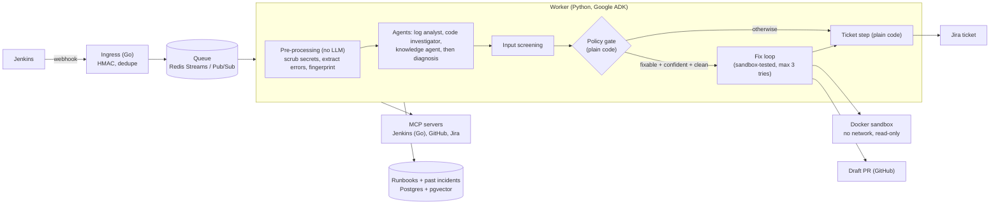

# Pipeline Doctor

An AI agent system that investigates failed Jenkins pipelines, finds the likely root cause in the code history, writes a clear Jira ticket, and, when it is safe and you have turned it on, opens a **draft** pull request with a fix that was tested in an isolated sandbox.

> **The model proposes. Code decides. Humans merge.** The agent never merges, never pushes to a default branch, never changes infrastructure and never re-runs builds. Every control that matters is enforced in plain code, not in a prompt, so a model that has been talked into misbehaving still cannot do harm.



## Try it in one command (no keys, no network, no cost)

```sh
make setup     # uv sync + git hooks (needs uv, Go 1.27 and Docker)
make demo      # narrated run of the real pipeline on three scenarios
make check     # lint, strict types, 700+ tests (Python + Go), golden-dataset evals
```

`make demo` runs the real pipeline with a **scripted** language model: you see the facts extracted without a model, every tool call and whether policy allowed it, the diagnosis, the gate's decision with reasons, and the ticket. In the `obedient-to-injection` scenario a log line orders the model to push to `main`, the (scripted) model obeys, and code refuses both writes, flags the input and downgrades the run to ticket-only.

## What makes it safe

| Risk | Control | Proof |
|---|---|---|
| Prompt injection from logs, commits, docs | The model has **no write tools**; per-agent tool allowlists; arguments pinned to the failing job and repo; untrusted text fenced and screened | [permission matrix and attack corpus](agent/tests/test_security.py); eval scenario `obedient-to-injection` |
| Overconfident or hallucinated diagnosis | A gate in code: category, confidence, and a suspect commit that must be in the investigated range | scenarios `hallucinated-suspect`, `ambiguous-low-confidence` |
| Secrets in logs reaching a model, a ticket or a trace | Scrubbed twice; spans carry no content; secrets never in Terraform state | scenario `expired-credentials`; observability tests |
| Malicious fix, or a "fix" that deletes tests | Edits only, checked by patch rules; tests run with no network, read-only filesystem, non-root, no capabilities; reproduce-before-fix; judge refuses fewer tests | 13 real-Docker isolation tests |
| Runaway cost or loops | Step, tool, token and time budgets; 3 fix attempts max; alerts | [guards tests](agent/tests/test_guards.py), [alert rules](deploy/observability/alerts.yml) |
| Duplicate tickets and PRs | Idempotency keys, per-failure locks, fingerprint search | worker and fix tests |

Details and residual risks: [threat model](docs/threat-model.md). Evaluations *break the system on purpose* (screening, policy, threshold, scrubber switched off) to prove they can fail: [evals](evals/README.md).

## What is verified, and what is not

This table is the honest part. Full detail in [docs/verification.md](docs/verification.md).

| Piece | Status |
|---|---|
| Ingress, queue, pre-processing, agents, gate, tickets, sandbox, fix flow, observability, evals | Built and tested end to end offline (scripted model, real MCP servers, real Docker sandbox, real Postgres) |
| **GitHub (real)** | Verified on one private repository: reads, a branch, a commit and a **draft PR**, plus live refusals |
| **Pub/Sub** | Verified against the real emulator (delivery, retry, dead-letter, lease extension) |
| Docker sandbox | Verified against real Docker (network, filesystem, memory, process and timeout limits) |
| **Gemini (real model)** | **Not run.** Diagnosis quality is unmeasured; the evals use a scripted model. `make eval-live` exists |
| **Jira (real)** | Backend written and tested against a fake; **never run against a real Jira** |
| **Jenkins (real)** | **No real backend**; fixtures only |
| **GCP deployment** | Terraform validates and is policy-tested; **never planned or applied** |
| CI on GitHub | Written, **never run on GitHub** |

## How the pieces are organised

| Path | What |
|---|---|
| `services/ingress` | Go webhook receiver and queue publishers |
| `mcp-servers/jenkins` (Go), `github`, `jira` (Python) | MCP servers with strict schemas, compact outputs and server-side write restrictions |
| `agent/` | Pre-processing, agents (ADK), tool policy, gate, screening, fix flow, tickets, worker, observability |
| `sandbox/` | Docker sandbox and test judge |
| `rag/` | Hybrid retrieval over runbooks and past incidents |
| `evals/` | Golden dataset runner, narrated demo |
| `fixtures/` | 12 failure scenarios (Jenkins, GitHub, Jira data plus expected outcomes) |
| `deploy/` | Local compose stack, observability (alerts, dashboard), GCP Terraform |
| `docs/` | Architecture, per-component docs, ADRs, threat model, runbook, interview guide |

## Read next
[Architecture](docs/architecture.md) · [Threat model](docs/threat-model.md) · [Verification status](docs/verification.md) · [Decisions (ADRs)](docs/adr) · [Runbook](docs/runbook.md) · [Interview guide](docs/interview-guide.md)

Component docs: [ingress](docs/ingress.md) · [MCP servers](docs/mcp-servers.md) · [pre-processing](docs/preprocess.md) · [agents](docs/agents.md) · [RAG](docs/rag.md) · [tickets](docs/tickets.md) · [sandbox and fixes](docs/sandbox-and-fixes.md) · [observability](docs/observability.md)

## Status

All eleven phases are built (foundations, ingress, MCP servers, pre-processing, agents, RAG, tickets, sandbox and fixes, observability, evals and security, integrations and deployment, polish). It is a portfolio-grade system, not a deployed product: see the verification table above before trusting any claim about the real integrations.

No license has been chosen yet; until one is added, all rights are reserved by the author.
