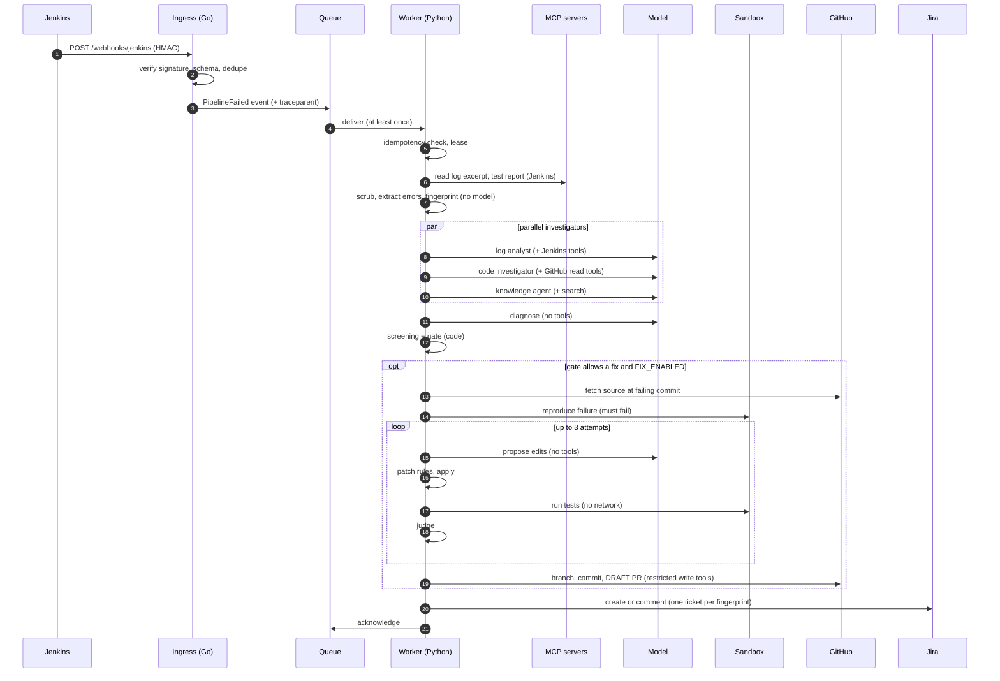

# Architecture

## One failure, end to end

## Components and what they trust

| Component | Language | Trusts | Does not trust |
|---|---|---|---|
| Ingress | Go | its shared secret | the request body until the HMAC verifies |
| Worker | Python (ADK) | its own code, MCP server schemas | every byte of build output, commits, documents, and the model |
| MCP servers | Go, Python | their own policy | the caller: they re-check scope, paths, branch names, repo allowlists |
| Policy layer | Python | nothing from the model | tool names, arguments, agent identity: all checked per call |
| Gate | Python | nothing from the model | a confidence number alone: also requires an in-range suspect and no screening flags |
| Sandbox | Docker | nothing | the repository, the patch, the dependencies |

## Design decisions (details in the ADRs)

| Decision | Why | ADR |
|---|---|---|
| Deterministic orchestration; LLM reasoning only inside steps | repeatable, testable, cheap; no model decides control flow | [0002](adr/0002-deterministic-orchestration.md) |
| Policy and gate are code | a persuaded model cannot change them | [0003](adr/0003-policy-gate-in-code.md) |
| Queue interface with Redis Streams and Pub/Sub | local simplicity, managed reliability in the cloud | [0004](adr/0004-queue-abstraction.md), [0010](adr/0010-pubsub-transport-and-cloud-run.md) |
| Hybrid retrieval (vector + full text) | exact error strings and meaning both matter | [0005](adr/0005-hybrid-retrieval.md) |
| The ticket step is code, not an LLM | writes cannot be steered by text hidden in logs | [0006](adr/0006-ticket-step-is-code.md) |
| Fix safety model | two identities, edits not diffs, reproduce first, sandbox, draft only | [0007](adr/0007-fix-safety-model.md) |
| Observability without content | traces and logs carry ids and counts, never build text | [0008](adr/0008-observability-design.md) |
| Hard-gate evals; screening as tripwire | safety must be perfect, quality must not regress | [0009](adr/0009-evals-and-input-screening.md) |

## Data stores
- **Redis:** idempotency keys, leases, locks (`pd:*`), webhook de-duplication; and the queue when running locally.
- **Postgres + pgvector:** runbooks and past incidents for retrieval (optional; the knowledge agent is a no-op without it).
- **Nothing else.** Beyond Jira and GitHub, the worker keeps only small per-event summaries in Redis (category, fingerprint, ticket key, PR link) for seven days.

## Deployments
- **Local:** `deploy/compose` (Redis, Postgres, ingress, optional Prometheus/Grafana/Jaeger); the worker runs on the host.
- **Google Cloud:** `deploy/terraform` (Pub/Sub, Cloud Run ingress and worker, Memorystore, Secret Manager, alerts). Validated, never applied. Fixes are off there: Cloud Run has no Docker for the sandbox.
