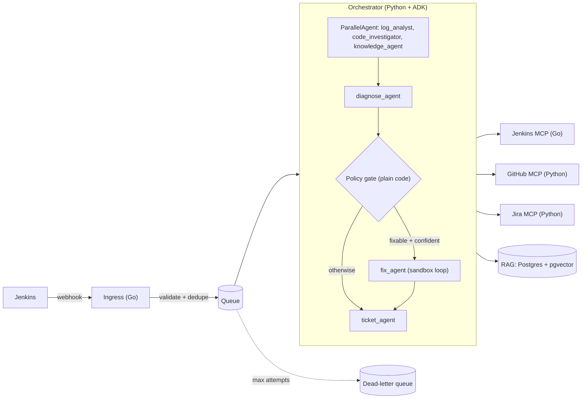

# Architecture

Principles: deterministic orchestration with LLM reasoning inside steps; the model proposes, code decides; all external content is untrusted; humans approve every code change.

Component docs are added as each phase lands.
